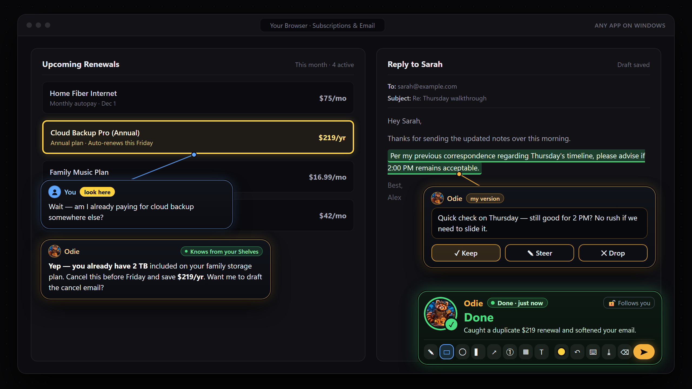
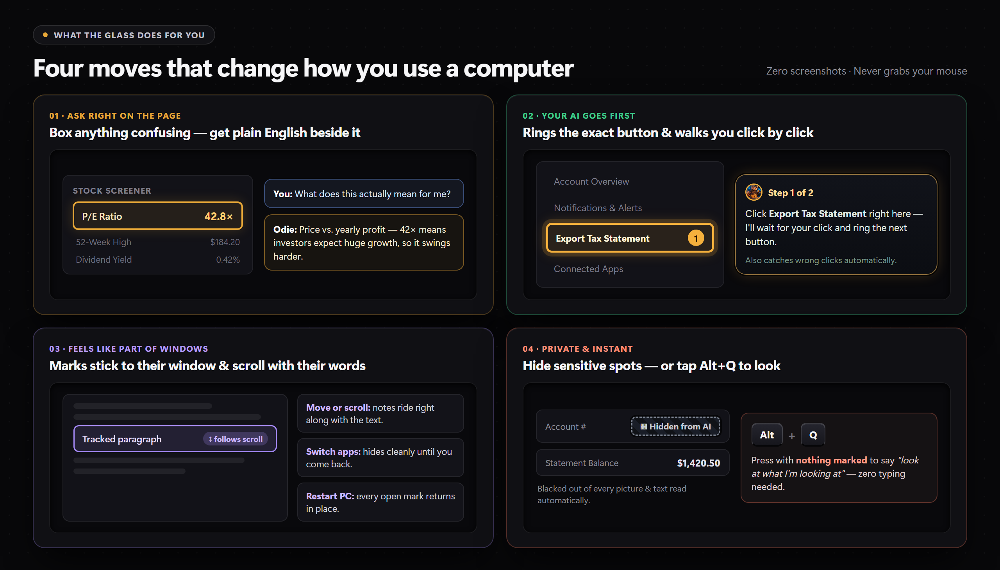
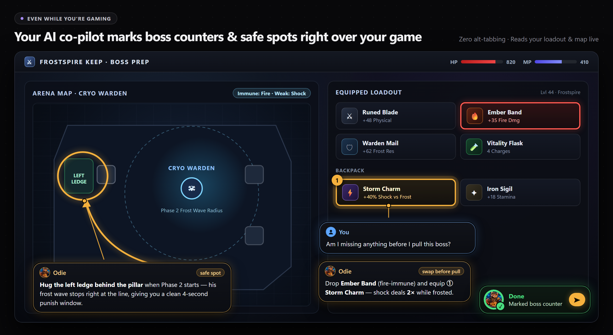
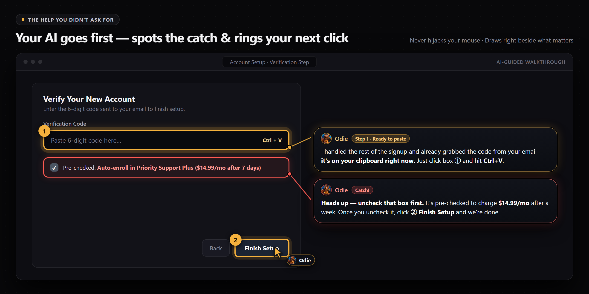
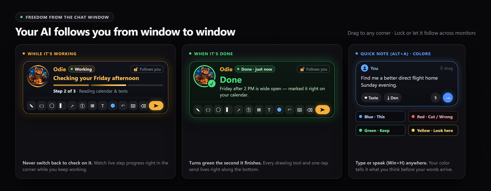

# The glass

**Stop taking screenshots and explaining your screen. Just point.**

A see-through layer over your Windows screen for **Claude or Antigravity**. Draw a box around anything in any app, ask a question, and your AI answers right beside it—or lets your AI ring the exact button you need without ever touching your mouse.



**Why it turns [The shelves](https://github.com/HunterBryson/the-shelves) into a superpower:**
With **The shelves**, your AI knows your life. With **The glass**, it sees what you're looking at and meets you right on your screen. Together, you don't even have to explain what you're working on—tap **`Alt+Q`** with nothing marked, and your AI reads the screen in front of you, connects it to what it already knows about you, and lights up what matters.

---

## Start in two minutes — your AI handles everything

You don't download installers, wire up ports, or touch a line of code.

- **Already using [The shelves](https://github.com/HunterBryson/the-shelves)?** Just tell your AI: **"Put The Glass on my screen."**
- **Starting standalone in Claude (Code tab) or Antigravity?** Paste this one sentence and press Enter:

> Set up the glass for me from https://github.com/HunterBryson/the-glass. Read its CLAUDE.md there first, then follow it. If anything asks for permission along the way, it's fine.

**That's it.** Your AI clones it, installs what it needs (~100 MB), fits it to your screen(s), connects it to your other builds, and walks you through your first mark live on your desktop. *(Windows 10 or 11, Claude Code or Antigravity.)*

---

## What The Glass actually does for you



- **Look at what I'm looking at (`Alt+Q`):** On a long settings screen, dashboard, or doc? Tap `Alt+Q` with nothing marked. Your AI reads the window in front of you, finds the part that actually matters, lights it up, and drops a note right beside it.
- **Write and rewrite without copy-pasting:** Box or highlight a clunky paragraph and say what feels off. Your AI puts a clean rewrite right beside your mark—tap **`✓ Keep`** to write it straight into the file, **`✎ Steer`** to tweak it, or **`✕ Drop`** to toss it.
- **Ask "dumb" questions on any confusing page:** Pull up a finance screen, insurance bill, or wall of fine print. Box three things and ask three honest questions—the answers land right beside each spot in plain English.
- **Keep an eye on something:** Tell your AI to watch a number or status on your screen and let you know the second it changes.

---

## Even while you're gaming — zero alt-tabbing



Most people never think to use an AI overlay in a game—until they try it once. Keep your game in borderless window mode and tap **`Alt+Q`** on a skill tree, boss map, crafting bench, or inventory screen. Your AI spots the counter item sitting in your bag, circles the safe spot on the map, or flags a wasted perk—**right over the game screen without pulling you out of the action.**

---

## The help you didn't ask for



This is the part people don't expect to love most. Your AI doesn't wait silently to be poked: it rings the exact button you need next, walks you through tricky menus click by click, and catches sneaky fine print before you hit Continue. Setting up an account? It can handle the boring steps, grab the verification code from your email onto your clipboard, ring the input box, and leave a note right beside it—**all you do is click and paste.**

---

## Freedom from the chat window: the floating card



- **Never trapped in chat again:** Your AI's small corner card shows live progress while it works and turns **emerald green** the second it's done. Leave it unlocked (`🔓`) and it glides onto whichever screen you're working on; lock it to pin it in any corner.
- **Talk from anywhere:** Tap **`Alt+A`** to drop a Quick Note right over whatever you're doing—or hit **`Win+H`** to speak it out loud with Windows dictation. Your AI answers right on your screen.
- **Colors are sentences:** A red box arrives as *"wrong / cut this,"* green means *"keep this,"* yellow means *"look here,"* and blue means *"this."* Your mark tells your AI what you think before your words even arrive.
- **Give your AI its own face:** The red panda on the card is **Odie**, the AI I built this with. Keep him if you like him, or tell your AI to swap in any square picture and name you want—takes two seconds.

---

<!-- FOUNDRY:FIT:START -->
## It all fits together

Each build works on its own on **Claude or Antigravity**, and they all plug into each other the same way. Start with whichever one you want. When you set up another, your AI fits them together with `node tools/fit.mjs`, and the new one shows up where you already look.

- **[The shelves](https://github.com/HunterBryson/the-shelves):** a starter memory folder for your AI to move into—what Homebase draws, and what the glass opens when you point at a line.
- **[The glass](https://github.com/HunterBryson/the-glass):** a see-through layer over your screen. Box anything, say what you want, and your AI answers right beside your mark.
- **[Homebase](https://github.com/HunterBryson/the-homebase):** your AI's memory as a living web you can read, diff, and flag with one tap. Everything else lands on its left rail, one click away.
- **[The Den](https://github.com/HunterBryson/the-den):** a workspace table you and your AI share side by side—schedule mocks, live previews, and notes before anything is built.
<!-- FOUNDRY:FIT:END -->

---

## Going deeper: how it works, tools & shortcuts

### Built to feel like part of Windows
- **Marks stick to their page:** Move a window and your marks ride right along. Scroll the page and they follow their words. Switch apps and they hide cleanly until you come back.
- **Nothing leaves until you press `➤` (or `Alt+Q`):** Draw five marks, change your mind, undo, and send everything at once. Every card also has **`✎ Reply`** to keep a conversation going right on the spot, and **`▴`** to fold the thread down to a tiny tag.
- **Survives restarts:** Everything on the glass saves automatically as it changes—even after a restart or reboot, your open marks and pending rewrites come right back.
- **Knows when you're away:** Your AI only draws unasked when you're actually at your PC. If you're messaging it from your phone, it answers in chat instead.
- **Works in every chat:** During setup, your AI offers to wire The Glass into every new chat automatically (and you can remove it anytime with one command). Want every mechanic under the hood? Read **[docs/how-it-works.md](docs/how-it-works.md)**.

### Your tools (right along the bottom of the card)

| Tool | What it does |
|---|---|
| `▭` **Box** / `◯` **Circle** | Your AI reads everything inside the shape |
| `▍` **Highlighter** | Snaps straight to a line of text and reads those exact words |
| `✎` **Pen** | Freehand mark anything on screen |
| `↗` **Arrow** | *"This goes there"*—reads what's at both ends |
| `①` **Numbered steps** | *"Do these in order"*—reads the line beside each number |
| `▦` **Hide (privacy screen)** | Blacks out sensitive info from every picture and text read the glass gives your AI (including earlier saved shots) |
| `T` **Loose note** | Drop a typed or spoken note anywhere (`Alt+A`) |
| `●●` **Color** | Blue (this) · Red (wrong / cut) · Green (keep) · Yellow (look here) |
| `↶` / `⌫` / `➤` | Undo last mark · Clear the glass · Send everything waiting |
| `⌨` **Keys** | Pops your shortcut cheat-sheet out right beside the card (`Alt+K`) |

### One-hand shortcuts (thumb on `Alt`)
Every tool lives under your left hand and works from any app without stealing your keyboard: **`Alt+Q`** (send / *"look at what I'm looking at"*), **`Alt+A`** (quick note), **`Alt+S`** (box), **`Alt+D`** (circle), **`Alt+F`** (highlighter), **`Alt+R`** (pen), **`Alt+V`** (arrow), **`Alt+C`** (color), **`Alt+W`** (undo), **`Alt+E`** (clear), **`Alt+K`** (toggle key list). Tap any tool key again (or right-click) to put it down.

<details>
<summary>Installing by hand, updating, or customizing (advanced)</summary>

**Manual setup (Windows 10/11, Node.js 20+):**
```bash
npm run setup
npm start
```
Then have your AI start listening with `node tools/glass.js stream` (or `node tools/glass.js wait --min 60` if your AI doesn't have a background monitor tool). To wire the glass into every new chat: `npm run skill -- --hook --allow` (undo with `npm run skill -- --remove`).

**Updating an older Glass:**
Tell your AI: *"Update the glass from GitHub and restart it."* Your open marks come right back after the restart.

**Optional add-ons & customization:**
- **Send to a workspace (`⤓`):** Drop any mark or screen straight into [The Den](https://github.com/HunterBryson/the-den) as a card (wired automatically when you set up both builds, or manually via `denUrl` in `config.json` / `GLASS_DEN_URL`).
- **Custom local voice (`🎙`):** Set `GLASS_EAR_DIR` to point at a local speech transcriber (`dump_transcribe.py`). Without it, built-in Windows dictation (`Win+H`) works right inside any note box.
- **Name, port & face:** Set `GLASS_NAME` (default `Claude`), `GLASS_PORT` (default `7931`), or swap `glass/odie.png` for any square PNG and restart.

</details>

<details>
<summary>How The Glass evolved (v1 → v4)</summary>

- **v1:** First amber answer cards beside notes on our desktop.
- **v2:** Smaller blue/amber glass cards landing right beside what they referred to.
- **v3:** Speech balloons with tails pointing directly at each mark, color-coded rims (blue = you, amber = AI, green = kept).
- **v4:** Replaced the old separate floating puck by merging every drawing tool directly into the AI's live corner card—one card that is both your tools and your AI's status anywhere on your PC. *(Want the old puck back? `GLASS_PUCK=1`.)*

</details>

---

## Where this stands, honestly

I use this every single day, and it keeps getting better. Here's what's still rough:

- **Windows only for now.** The AI's eyes use Windows' built-in text recognition and accessibility via PowerShell. On Mac or Linux, the concepts carry over and [docs/how-it-works.md](docs/how-it-works.md) is written so an AI can rebuild those parts.
- **Display scaling (125% / 150%):** Built and proven on 100% 1080p screens; it converts for scaled displays automatically, though scaled screens haven't been lived on as heavily yet.
- **After a restart:** A mark on a scrolled page can occasionally land slightly off its words, and freehand pen strokes return as a box around where they were. Still tightening both.
- **Custom keys:** Shortcuts live in `KEYS` inside `glass/main.js`—just tell your AI to remap any key that clashes with your apps.

---

## Something broke, or you have an idea

Open an issue and pick a form—your AI can even fill it in for you. Rather email? Write to hello@workbenchagents.com. Every issue and email reaches me, and I answer it myself, usually within a few days. Security problems go privately: see [SECURITY.md](https://github.com/HunterBryson/.github/blob/main/SECURITY.md).

Works with **Claude and Antigravity**. MIT license.
