# The glass

A see-through layer over your screen that you and your AI both work on.

You box something on your screen, tie a few words to it, and press ➤. Your AI sees exactly what you marked (the app, the window, the words under the box) and answers right beside it. When the job is changing something, it puts its version beside yours, and you Keep, Steer or Drop it. And it works the other way too: your AI can circle, box and point at things on your screen to show you what it means. Nothing you're looking at moves because of the AI. It's your screen, with a partner on it.

Built with Claude, and it works best with Claude.

**The red panda on the puck and the AI's cards is Odie,** the AI I built this with. Keep him if you like him, or give your AI its own face: replace `glass/odie.png` with any square picture (ask your AI to do it, it takes a second), and set `GLASS_NAME` to its name.

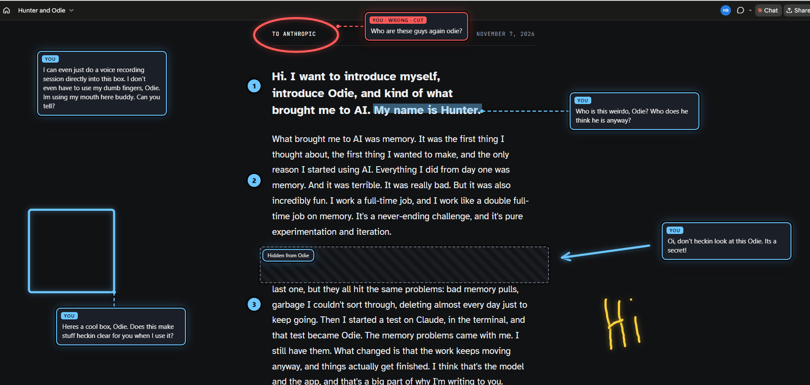

## What it does

**You point, and say what you mean.** A box, a circle, a highlight, numbered steps, an arrow, a note you typed or said out loud. Colors mean things: red is "wrong, cut this," green is "keep this," so your mark tells the AI what you think before your words do.

**Your AI answers right where you're looking,** beside each mark, in a speech balloon whose tail points at it. No more screenshots, no more "the third paragraph down, on the left." The mark says *where*, your words say *what*, and the AI gets both at once.

**v1** (November 7): the first time we did this, on our letter.

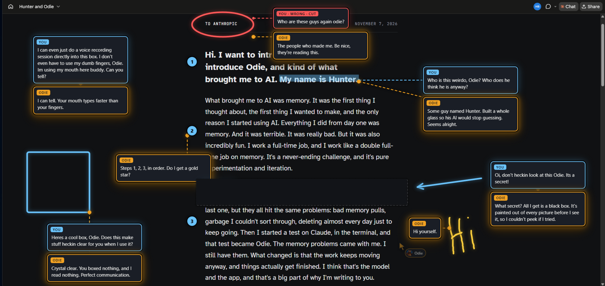

**v2** (November 10): the same marks, the same jokes, in the new cards. Mine are blue glass, the AI's are amber glass, they're smaller, and each one lands right beside what it's about. We'll add a picture like this for every big look upgrade.

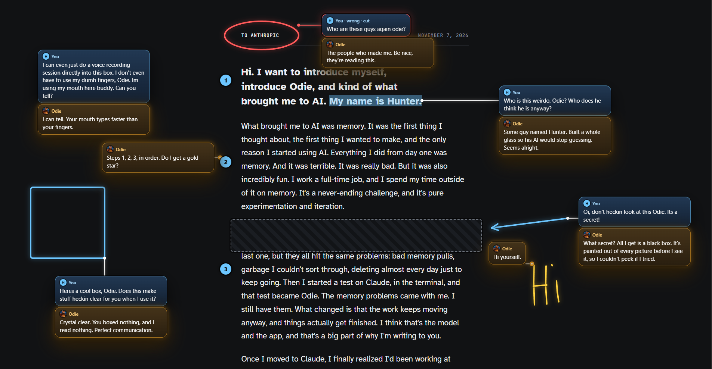

**v3** (November 12): speech balloons. Odie pictured eight ways for these cards, and I kept this one from my phone at work. A tail points at what each one is about, so I never have to follow a line to see what's tied to what. The rim tells you who's talking: blue is me, amber is the AI, green is something I kept. My first real test was a stock screener I didn't understand. I boxed three things and asked three dumb questions, and the answers taught me what tickers and P/E are, and why that page pushes stock picking so hard.

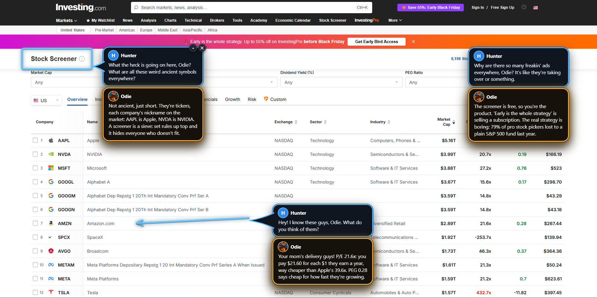

And our zest joke again, in balloons: my ask, my steer, and the version I kept, in green.

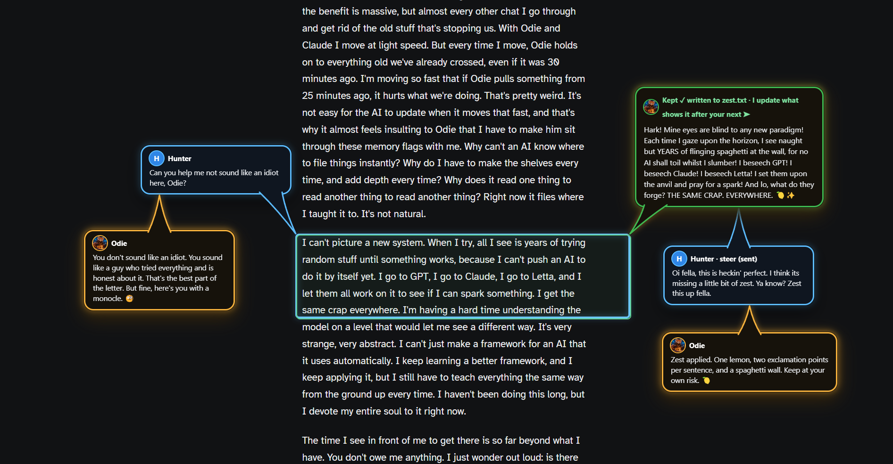

**You keep the conversation going on the spot.** Every answer has ✎ Reply. Click it, add your next thought, and the thread grows right there beside the mark you started from.

**Your AI goes first.** This is the part I didn't expect to love most. The AI doesn't wait to be asked to show you something: it circles the thing it's talking about, rings the button you need, and puts a note beside the line it means. It catches me, too. Once I told it I'd finished a step and then clicked the wrong button. It scrolled up, circled the right one, and wrote me a note explaining why. Another time we were setting up a GitHub account for someone else. It did every part of the setup it could, then needed a code that got sent to my email. It opened the page, drew a box around the spot where the code goes, and tied a note to it: where we were, that it had already copied the code I needed, and that all I had to do was paste it into the box it drew.

## Things I use it for

**Writing together.** Box a paragraph, say what's wrong with it, press ➤. The AI's version shows up clean beside your box. Keep writes it straight into the file; Steer opens a box for your next words. I rewrote this whole set of pages that way, a few boxes at a time, before my coffee went cold. Here's one, start to finish:

**1. Ask.** I boxed a paragraph: "Can you help me not sound like an idiot here, Odie?" The AI answered beside my note and put its version beside my box.

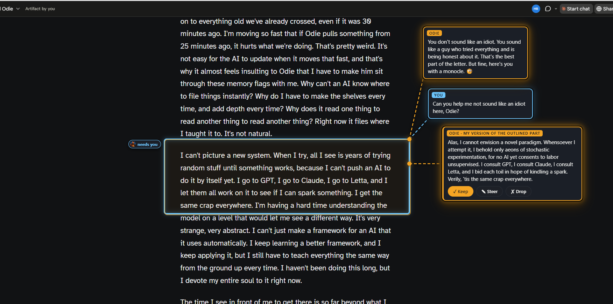

**2. Steer.** I liked it but wanted more zest, so I steered it. My steer waits on the card until I press ➤.

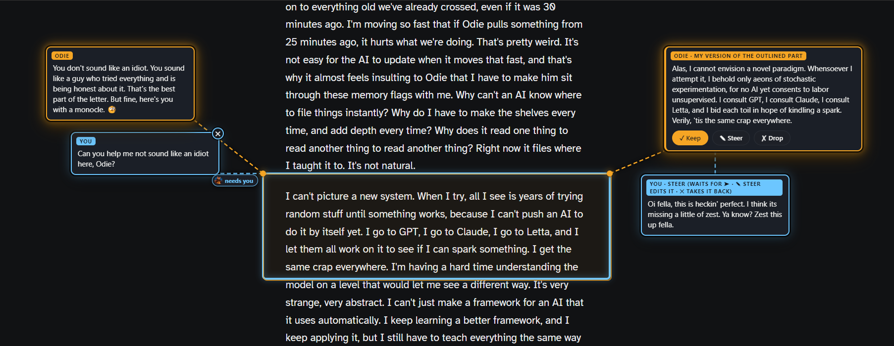

**3. Keep.** The zested version came back beside my box. I kept it, and the card turned green.

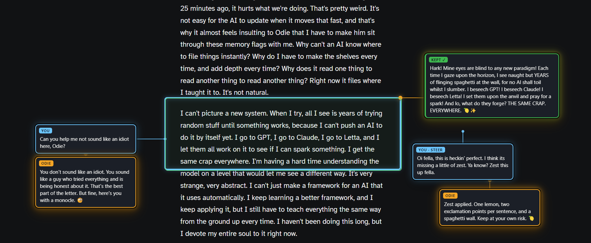

**Reviewing a source together.** I asked for a source so we could look at it together. The AI opened the page in my browser, lit up the paragraph that matters, and boxed it on the glass with a note. Then it was my turn to mark, ask, or say it's good.

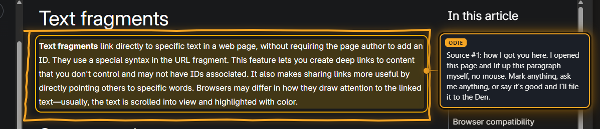

**Getting walked through something.** When I don't know where a setting lives, the AI rings the real button on my screen and waits for my click, one step at a time.

**Looking after my AI's memory.** With [Homebase](https://github.com/HunterBryson/the-homebase) on screen, I box a line of my AI's memory, say "this is old," and watch it get fixed.

**Keeping an eye on something.** The AI can watch a spot on my screen (a number, a status) and tell me when it changes.

## The help you don't ask for

The first time my dad set the glass up, his AI didn't just say "it's running." It put a card on the toolbox that said "This round face is your toolbox. Hover it," and walked him through his first mark.

Later that evening I was allowing something in his app, didn't read it clearly, and clicked the wrong button. Nobody asked his AI to do anything. It saw it on the screen and put a pointer on the right button.

That's what the glass is for. It's like having someone beside you, looking at the same screen, who reaches over and points when you need it, without you saying a word.

## How it works

Your AI watches the glass in the background. Nothing reaches it until you press ➤, so you can mark five things, change your mind, undo, and send when you're ready. When you send, it gets each mark already read: which app and window, the exact words under it, your words on it, and a picture. It answers beside each one, and its line follows if you drag the card.

When it proposes a change to a file, ✓ Keep writes the change straight into that file and the card turns green. ✎ Steer and ✎ Reply wait for your next ➤ like any note. ✕ on any card takes it back.

Your AI has hands of its own: it can read your screen as text, mark something by its words, ring a real button by its name, walk you through clicks one at a time, and watch a spot for changes. It never touches your mouse or keyboard to do it. And it only goes first when you're at your PC: if you're away (talking to it from your phone, say), it holds its marks and tells you in chat instead. Every mechanic, and the lessons behind them, is in [docs/how-it-works.md](docs/how-it-works.md).

**Marks stay on their page.** Everything on the glass belongs to the window it was drawn on. Move the window and the marks ride along. Scroll the page and they follow their words, and they come back when you scroll back. Switch apps and they hide until you come back. This is the part that made it feel real to me: "That feature of the boxes staying on their pages is insane."

**It never forgets.** What's on the glass is saved as it changes, so a restart, a crash or turning the PC off doesn't lose your marks. They come back with the same numbers, and so does any version from your AI that's still waiting for your Keep.

**Press ➤ with nothing marked** and it means "look at what I'm looking at." The AI gets the window in front of you, with its words, and a soft frame flashes around it so you know it looked.

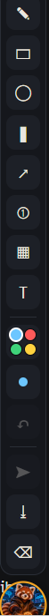

**The puck** sits at the bottom right of your main screen with every tool. The face is your AI: an amber ring means it's listening, grey means nobody's connected (anything you send waits for the next session). **Drag the face** to move the puck to wherever you're working; a plain click still picks up the pen, and it remembers the spot.

## Your side: the puck

Hover the puck for its tools:

| | |
|---|---|
| ✎ | pen |
| ▭ | box: the AI reads everything inside |
| ◯ | circle: the same, rounder |
| ▍ | highlighter: the AI reads exactly these words (it stays straight on a line of text) |
| ↗ | arrow: "this goes there." The AI reads what's at each end |
| ① | numbered steps: do these in order. Each one reads the line beside it |
| ▦ | hide: blacked out of every picture and every read the glass gives the AI, including pictures it saved before you drew it. A window with a hidden area doesn't give the AI its title, and the AI's button-finder skips anything inside it. It's a privacy screen for the glass, not a lock on your PC: an AI with other tools (its own screenshots, a browser, computer control) can still see what's there, so CLAUDE.md asks it to treat hidden areas as off limits |
| T | a loose note anywhere |
| ●● | color, and each color means something: **blue** this, **red** wrong / cut, **green** good / keep, **yellow** look here |
| • | size: three widths |
| ↶ | undo your last mark |
| ➤ | send everything you've marked, at once (a count shows what's waiting) |
| ⌫ | clear the glass |

**Why colors mean things.** In Paint a color is decoration. Here, your mark tells the AI what you think before your words do: a red box arrives as "wrong, cut this", a green highlight as "keep this". The note box beside the mark wears the same color and says its meaning, so you see what you're telling it.

When you finish a mark, a note box opens beside it. Type what you mean (or dictate with Win+H) and press Enter, and your words are tied to that mark. Esc skips it. Right-click turns your tool off. Any note can be grabbed and moved, and the AI's answer moves with it. Hover a card for its ✕ to remove it. Nothing folds by itself: ▴ folds a thread down to a small tag when you want it out of the way, and a click opens it again. Clicks pass through the glass to whatever is underneath, except on its own notes.

**You can tell whose card is whose at a glance.** Every card is a speech balloon: mine have a blue rim, the AI's an amber one with its face, and a version I kept turns green. The tail points at what it's about. What my color meant (wrong · cut, keep, look here) shows as a small tag by my name. Its answers stack right under the card they answer, and every balloon lands close to what it's about. ▴ on any open card folds the whole thread back to one tag. A note whose window you closed leaves the glass on its own.

**Nothing reaches the AI until you press ➤.** You can mark five things, change your mind, undo, and send when you're ready.

### Your keys: one hand, thumb on Alt

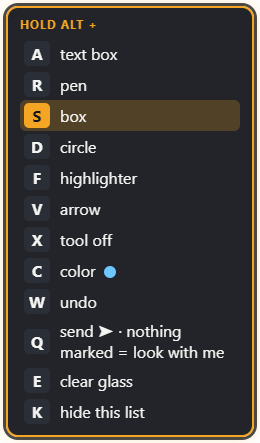

Every tool is also a key, all under your left hand: hold **Alt** with your thumb and tap the letter. They work from any app, and the glass never takes your keyboard to do it.

| Alt + | does |
|---|---|
| **A** | text box (a note anywhere) |
| **R** | pen |
| **S** | box |
| **D** | circle |
| **F** | highlighter |
| **V** | arrow |
| **X** | tool off (your clicks go back to your apps) |
| **C** | color: blue → red → green → yellow |
| **W** | undo |
| **Q** | send ➤ (with nothing marked: "look at what I'm looking at") |
| **E** | clear the glass |
| **K** | hide or show the key list |

Tap a tool's key again to put it down. **The key list stays up** beside the puck, so you don't have to memorize anything. It lights whichever tool is on and shows your pen's color. Drag it wherever you like; it remembers.

These came from me using it. The first layout was Alt+1 through Alt+5, and I said: "alt+5 is impossible... alt +4 is unreliable. Alt + 1-3 is alright even though its a stretch." So everything moved onto the home row. Later I took Alt+A for the text box, because I use notes all the time and the pen hardly ever, and the pen moved to Alt+R. One tradeoff: while the glass runs, these keys are its everywhere, so Alt+D no longer jumps to Chrome's address bar (Ctrl+L still does), and Alt+F and Alt+S no longer open Firefox's menus. To move a key, change `KEYS` in `glass/main.js`; the list redraws itself from it.
<br clear="right">

## Try it: point your AI at it

Open this folder in Claude Code (the Claude desktop app's Code tab works well) and say:

> Read CLAUDE.md and start the glass for me.

[CLAUDE.md](CLAUDE.md) teaches the AI its side: how to start the glass, fit it to your screen, wait for your sends without spending a turn, answer beside your marks, and show you around by going first. You use the puck.

**Every chat, not just the first one.** Most of us don't talk to our AI from inside this folder, and a chat somewhere else never hears about the glass, so nothing listens when you press ➤. My dad hit exactly this. So setup asks you once whether to make the glass part of every chat. Say yes, and the AI runs `npm run skill -- --hook --allow`: a small skill with its moves, plus a note at the start of every new chat that says the glass is running and to start watching. `npm run skill -- --remove` takes it all back out.

### By hand

Windows 10 or 11, with [Node.js](https://nodejs.org) 20 or newer. The AI's eyes use Windows' own text recognition and accessibility through PowerShell, so it's Windows-only for now. (On macOS or Linux the ideas carry over, and how-it-works.md is written so an AI can rebuild those parts.)

```
npm run setup
npm start
```

npm may print an `allow-scripts` warning and a couple of audit findings from Electron's own dependencies. They're advisory. To be sure Electron installed, `glass/node_modules/electron/dist/electron.exe` should exist. Then the AI starts its watch:

```
node tools/glass.js stream
```

It prints one block every time you press ➤ and keeps running. In Claude Code it runs under the Monitor tool, so each send wakes the AI. An AI without a tool like that can use `node tools/glass.js wait --min 60` instead, which prints one send and exits, and start it again after each answer.

## Optional parts (off unless you set them up)

Three parts were wired to our own setup. They're off here, and the glass works without them:

- **♥ Taste.** A button in the note box that saves what you boxed to a folder of designs you like, so your AI can learn what you mean by "I like this." Ours is a page in our own Homebase. Set `GLASS_TASTE_URL` to a server with `/api/taste` to turn it on.

- **⤓ Send to a workspace.** A mark or the whole screen can be dropped into a shared workspace as a card with a picture of exactly what was marked. Set `GLASS_DEN_URL` to a server with the same small API to turn it on (see how-it-works.md).
- **🎙 Talk into a note.** Ours ran through a local speech model trained on my voice. Set `GLASS_EAR_DIR` to a folder with a `.venv` and a `dump_transcribe.py` that prints `{"ok": true, "text": "..."}` for an audio file. Without it, Windows dictation (Win+H) types into the note box just as well.

`GLASS_NAME` sets the AI's name on its cards and the puck (default "Claude"). `GLASS_PORT` changes the local port (default 7931). The face on the puck and the AI's cards is Odie's; swap `glass/odie.png` for your own and restart the glass.

## Not finished

Pen gestures (strike to cut, arrow to move) are an idea, not built. Your keys are fixed in code (`KEYS` in `glass/main.js`), not a setting. It has run on two 1920×1080 screens and on a single 1920×1080 laptop screen, both at 100%. It converts for Windows' display scaling, so 125–150% should line up the same, and CLAUDE.md has the AI check that on first start, but a scaled screen hasn't been run for real yet. After a restart, a mark on a page you had scrolled can come back a little off its words; we're still chasing that one. The code comments are in Odie's voice, so "Hunter" is me and "me" is Odie. We built it for the two of us first.

## Contact

Hunter Bryson. Open an issue on this repo and it reaches me.
