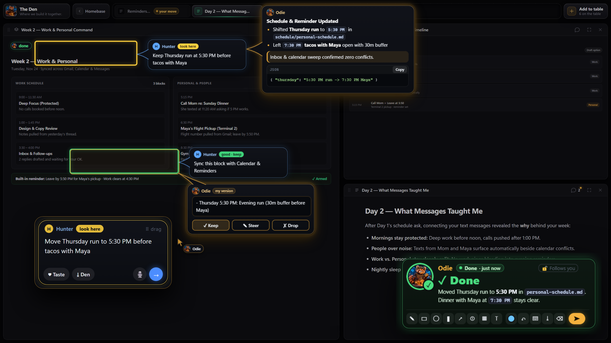
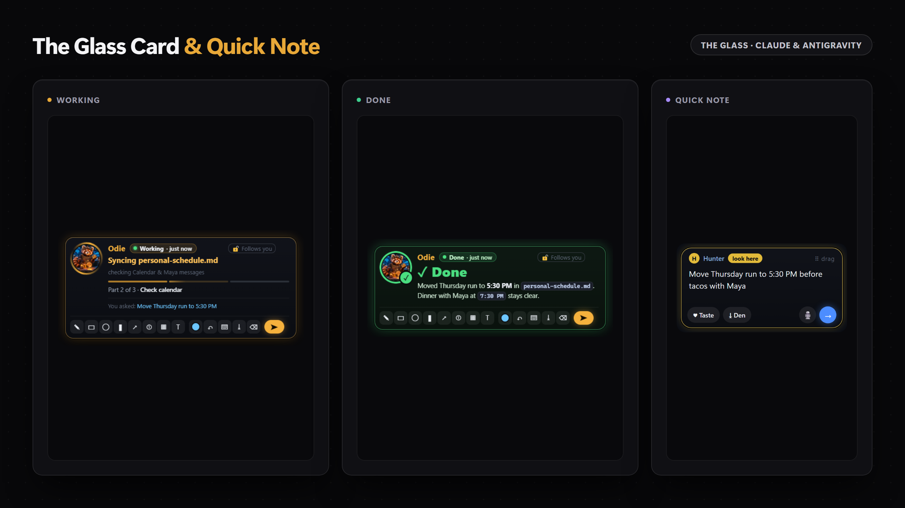
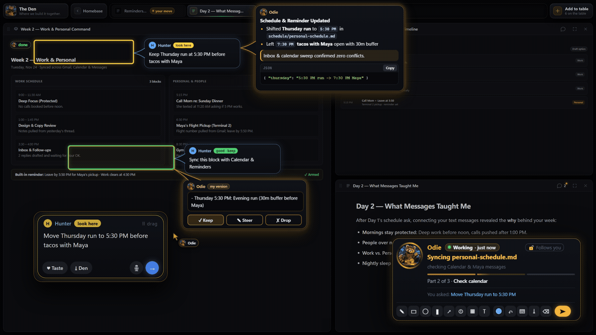

# The glass

A see-through layer over your screen that you and your AI both work on.

You box something on your screen, tie a few words to it, and press ➤. Your AI sees exactly what you marked (the app, the window, the words under the box) and answers right beside it. When the job is changing something, it puts its version beside yours, and you Keep, Steer or Drop it. And it works the other way too: your AI can circle, box and point at things on your screen to show you what it means. Nothing you're looking at moves because of the AI. It's your screen, with your AI on it.

**Start with one real ask. Watch it become something special to you.** Built for anyone who wants to try it out on **Claude or Antigravity**—glow cards, clickable screen marks, zero corporate setup wall.

**The red panda on the card and the AI's answers is Odie,** the AI I built this with. Keep him if you like him, or give your AI its own face: replace `glass/odie.png` with any square picture (ask your AI to do it, it takes a second), and set `GLASS_NAME` to its name.

## Freedom from the chat: the card



This is how I work now. Odie and I are in the Den building something, and I don't keep going back to the chat to see if it's working or what's going on. The card up in the corner shows me exactly what my AI is doing. I can see when it's looking at my screen, and which step it's on, so I know how close it is to finishing. When it's done, it turns green and says so.



**It goes where you want it.** Lock it and it stays right there. Unlock it, and you can drag it to snap to any corner of any screen. Unlocked, it follows you: click over to your other screen (say your AI just pulled something up there) and the card moves right on top of it. Your AI's chat follows you everywhere you go. You're not pinned to the chat anymore, so you can use the glass all the time.

**You don't even need the chat to talk.** Drop a text box with the glass (Alt+A), type what you'd type in chat, or say it out loud with Windows' dictation (Win+H), and send. The AI answers the exact same way, right there on your screen. No distractions, and it's very flexible.

**Every glass tool is a button on the card,** so you can put it wherever is convenient when you're working with your AI. ⌨ pops out the keys. I use the keys for everything, so it's all instant. I use the glass so much now it's kind of built into everything I do.

**The whole idea:** mark a bunch of things on your screen (or your AI marks them first), then send with Alt+Q or the orange arrow. Your AI gets a skill built from everything Odie and I learned making this, so it works smoothly from the start.

Red with "Not connected" means no chat is listening right now; anything you send waits for the next one.

## What it does

**You point, and say what you mean.** A box, a circle, a highlight, numbered steps, an arrow, a note you typed or said out loud. Colors mean things: red is "wrong, cut this," green is "keep this," so your mark tells the AI what you think before your words do.



**Your AI answers right where you're looking,** beside each mark, in a speech balloon whose tail points at it. No more screenshots, no more "the third paragraph down, on the left." The mark says *where*, your words say *what*, and the AI gets both at once.

**You keep the conversation going on the spot.** Every answer has ✎ Reply. Click it, add your next thought, and the thread grows right there beside the mark you started from.


## Things I use it for

**Looking at something together.** This is the one I use most. I'm on a long page (a settings screen, a doc, a dashboard) and I press Alt+Q with nothing marked. That means "look at what I'm looking at." My AI already knows what we're working on, so I don't explain anything. It finds the part that matters, lights it up, and puts a note beside it.

**Writing together.** Box a paragraph, say what's wrong with it, press ➤. The AI's version shows up clean beside your box. Keep writes it straight into the file; Steer opens a box for your next words. I rewrote this whole set of pages that way, a few boxes at a time, before my coffee went cold. Here's one, start to finish:

**1. Ask, then steer.** I boxed a paragraph: "Can you help me not sound like an idiot here, Odie?" The AI answered beside my note and put its version beside my box. I liked it but wanted more zest, so I steered it. My steer waits on the card until I press ➤.

**2. Keep.** The zested version came back beside my box. I kept it, and the balloon turned green.

**Getting sources without lifting a finger.** I was being silly and asked Odie to find me some sources on how to plug in a microwave. It took care of the rest: found GE's own support page, opened it on my screen, boxed the paragraph that matters, and marked the fine print, each with a note. I didn't lift a finger.

**Asking dumb questions.** I pulled up a stock screener I didn't understand, boxed three things and asked three dumb questions. The answers taught me what tickers and P/E are, and why that page pushes stock picking so hard.

**Getting walked through something.** When I don't know where a setting lives, the AI rings the real button on my screen and waits for my click, one step at a time.

**Keeping an eye on something.** The AI can watch a spot on my screen (a number, a status) and tell me when it changes.

## The help you don't ask for

This is the part I didn't expect to love most. The AI doesn't wait to be asked to show you something: it circles the thing it's talking about, rings the button you need, and puts a note beside the line it means. It catches me, too. Once I told it I'd finished a step and then clicked the wrong button. It scrolled up, circled the right one, and wrote me a note explaining why. Another time we were setting up a GitHub account for someone else. It did every part of the setup it could, then needed a code that got sent to my email. It opened the page, drew a box around the spot where the code goes, and tied a note to it: where we were, that it had already copied the code I needed, and that all I had to do was paste it into the box it drew.


<!-- FOUNDRY:FIT:START -->
## It all fits together

Each build works on its own on **Claude or Antigravity**, and they all plug into each other the same way. Start with whichever one you want. When you set up another, your AI fits them together with `node tools/fit.mjs`, and the new one shows up where you already look.

- **[The shelves](https://github.com/HunterBryson/the-shelves):** a starter memory folder for your AI to move into—what Homebase draws, and what the glass opens when you point at a line.
- **[The glass](https://github.com/HunterBryson/the-glass):** a see-through layer over your screen. Box anything, say what you want, and your AI answers right beside your mark.
- **[Homebase](https://github.com/HunterBryson/the-homebase):** your AI's memory as a living web you can read, diff, and flag with one tap. Everything else lands on its left rail, one click away.
- **[The Den](https://github.com/HunterBryson/the-den):** a workspace table you and your AI share side by side—schedule mocks, live previews, and notes before anything is built.
<!-- FOUNDRY:FIT:END -->

## How it works

Your AI watches the glass in the background. Nothing reaches it until you press ➤, so you can mark five things, change your mind, undo, and send when you're ready. When you send, it gets each mark already read: which app and window, the exact words under it, your words on it, and a picture. It answers beside each one, and its line follows if you drag the card.

When it proposes a change to a file, ✓ Keep writes the change straight into that file and the card turns green. ✎ Steer and ✎ Reply wait for your next ➤ like any note. ✕ on any card takes it back.

Your AI has hands of its own: it can read your screen as text, mark something by its words, ring a real button by its name, walk you through clicks one at a time, and watch a spot for changes. It never touches your mouse or keyboard to do it. And it only goes first when you're at your PC: if you're away (talking to it from your phone, say), it holds its marks and tells you in chat instead. Every mechanic, and the lessons behind them, is in [docs/how-it-works.md](docs/how-it-works.md).

**Marks stay on their page.** Everything on the glass belongs to the window it was drawn on. Move the window and the marks ride along. Scroll the page and they follow their words, and they come back when you scroll back. Switch apps and they hide until you come back. This is the part that made it feel real to me: "That feature of the boxes staying on their pages is insane."

**It never forgets.** What's on the glass is saved as it changes, so a restart, a crash or turning the PC off doesn't lose your marks. They come back with the same numbers, and so does any version from your AI that's still waiting for your Keep.

**Press ➤ with nothing marked** and it means "look at what I'm looking at." The AI gets the window in front of you, with its words, and a soft frame flashes around it so you know it looked.

## Your side: the tools

They're along the bottom of the card:

| | |
|---|---|
| ✎ | pen |
| ▭ | box: the AI reads everything inside |
| ◯ | circle: the same, rounder |
| ▍ | highlighter: the AI reads exactly these words (it stays straight on a line of text) |
| ↗ | arrow: "this goes there." The AI reads what's at each end |
| ① | numbered steps: do these in order. Each one reads the line beside it |
| ▦ | hide: blacked out of every picture and every read the glass gives the AI, including pictures it saved before you drew it. A window with a hidden area doesn't give the AI its title, and the AI's button-finder skips anything inside it. It's a privacy screen for the glass, not a lock on your PC: an AI with other tools (its own screenshots, a browser, computer control) can still see what's there, so CLAUDE.md asks it to treat hidden areas as off limits |
| T | a loose note anywhere |
| ●● | color, and each color means something: **blue** this, **red** wrong / cut, **green** good / keep, **yellow** look here |
| • | size: three widths |
| ↶ | undo your last mark |
| ➤ | send everything you've marked, at once (a count shows what's waiting) |
| ⌨ | your keys pop out beside the card |
| ⌫ | clear the glass |

**Why colors mean things.** In Paint a color is decoration. Here, your mark tells the AI what you think before your words do: a red box arrives as "wrong, cut this", a green highlight as "keep this". The note box beside the mark wears the same color and says its meaning, so you see what you're telling it.

When you finish a mark, a note box opens beside it. Type what you mean (or dictate with Win+H) and press Enter, and your words are tied to that mark. Esc skips it. Right-click turns your tool off. Any note can be grabbed and moved, and the AI's answer moves with it. Hover a card for its ✕ to remove it. Nothing folds by itself: ▴ folds a thread down to a small tag when you want it out of the way, and a click opens it again. Clicks pass through the glass to whatever is underneath, except on its own notes.

**You can tell whose card is whose at a glance.** Every card is a speech balloon: mine have a blue rim, the AI's an amber one with its face, and a version I kept turns green. The tail points at what it's about. What my color meant (wrong · cut, keep, look here) shows as a small tag by my name. Its answers stack right under the card they answer, and every balloon lands close to what it's about. ▴ on any open card folds the whole thread back to one tag. A note whose window you closed leaves the glass on its own.

**Nothing reaches the AI until you press ➤.** You can mark five things, change your mind, undo, and send when you're ready.

### Your keys: one hand, thumb on Alt

Every tool is also a key, all under your left hand: hold **Alt** with your thumb and tap the letter. They work from any app, and the glass never takes your keyboard to do it. Tap a tool's key again to put it down.

**This is what you see when you press ⌨ on the card** (or Alt+K): the key list pops out right beside it, lights whichever tool is on, and shows your pen's color. Keep it up while you're learning, and put it away when you're not.

**Alt+Q is the one to remember.** It sends everything you've marked, and with nothing marked it means "look at what I'm looking at."


## Try it: point your AI at it

Paste this to your AI in **Claude Code** or **Antigravity**:

> Set up the glass for me from https://github.com/HunterBryson/the-glass. Read its CLAUDE.md there first, then follow it. If anything asks for permission along the way, it's fine.

Your AI clones it, installs it, fits it to your screen, and shows you around by going first. Windows, with [Node](https://nodejs.org) and Claude Code or Antigravity. It downloads about 100 MB.

Already have the folder? Open it in your AI and say "Read CLAUDE.md and start the glass for me."

[CLAUDE.md](CLAUDE.md) teaches the AI its side: how to start the glass, fit it to your screen, wait for your sends without spending a turn, answer beside your marks, and show you around by going first. You use the card.

**Your AI starts with everything Odie and I learned the hard way.** Answer where you're looking, put every change right in front of you, keep one window per thing instead of flooding your screen, never fire without your send, look before saying it worked. It works the same whether or not you use any of my other builds; if you do (the Den, Homebase, the shelves), your AI fits them together with `node tools/fit.mjs`.

**Every chat, not just the first one.** Most of us don't talk to our AI from inside this folder, and a chat somewhere else never hears about the glass, so nothing listens when you press ➤. So setup asks you once whether to make the glass part of every chat. Say yes, and the AI runs `npm run skill -- --hook --allow`: a small skill with its moves, plus a note at the start of every new chat that says the glass is running and to start watching. `npm run skill -- --remove` takes it all back out.

### By hand

Windows 10 or 11, with [Node.js](https://nodejs.org) 20 or newer. The AI's eyes use Windows' own text recognition and accessibility through PowerShell, so it's Windows-only for now. (On macOS or Linux the ideas carry over, and how-it-works.md is written so an AI can rebuild those parts.)

```
npm run setup
npm start
```

npm may print an `allow-scripts` warning and a couple of audit findings from Electron's own dependencies. They're advisory. To be sure Electron installed, `glass/node_modules/electron/dist/electron.exe` should exist. Then the AI starts its watch:

```
node tools/glass.js stream
```

It prints one block every time you press ➤ and keeps running. In Claude Code it runs under the Monitor tool, so each send wakes the AI. An AI without a tool like that can use `node tools/glass.js wait --min 60` instead, which prints one send and exits, and start it again after each answer.

## Updating

Already running an older glass? Tell your AI:

> Update the glass from GitHub and restart it.

It runs `git pull`, then `npm run setup` if `glass/package.json` changed, then `npm run skill -- --hook --allow` again if you use the skill (so it has the newest moves), then `node tools/glass.js restart`. Whatever is on your glass comes back after the restart. If you changed files of your own, keep them on a branch so the pull stays clean. Got it as a zip? Download it again and copy your old `glass/data` folder into the new one.

## Optional parts (off unless you set them up)

Two optional parts were wired to our own setup and stay off unless configured:

- **⤓ Send to a workspace.** A mark or the whole screen can be dropped into a shared workspace (like [the Den](https://github.com/HunterBryson/the-den)) as a card with a picture of exactly what was marked. Set `denUrl` in `config.json` (done automatically by `fit.mjs`) or `GLASS_DEN_URL` to turn it on.
- **🎙 Talk into a note.** Ours ran through a local speech model trained on my voice. Set `GLASS_EAR_DIR` to a folder with a `.venv` and a `dump_transcribe.py` that prints `{"ok": true, "text": "..."}` for an audio file. Without it, Windows dictation (Win+H) types into the note box just as well.
- *(Optional `GLASS_TASTE_URL` env/config hook is also supported if you connect an external `/api/taste` endpoint.)*

`GLASS_NAME` sets the AI's name on the card and its answers (default "Claude"). `GLASS_PORT` changes the local port (default 7931). The face on the card and the AI's answers is Odie's; swap `glass/odie.png` for your own and restart the glass.

## How it got here

The glass has changed a lot in its first week. Here's a picture for every big look upgrade.

**v1** (November 7): the first time we did this, on our letter—amber answer cards beside each note.

**v2** (November 10): the same marks, the same jokes, in smaller glass cards—blue glass for my notes and amber glass for the AI's answers, each landing right beside what it's about.

**v3** (November 12): speech balloons. Odie pictured eight ways for these cards, and I kept this one from my phone while I was out. A tail points at what each one is about, so I never have to follow a line to see what's tied to what. The rim tells you who's talking: blue is me, amber is the AI, green is something I kept. The stock screener up in "Things I use it for" is v3.

**v4** (November 14): the puck is gone. I lost it all the time and could never find it, so all my tools moved into the AI's card, the one that shows what it's doing. The puck and the bubble being meshed together is actually what it should be: one card that's my tools and my AI at the same time, so I can work on the glass and not need the chat. Its own section is at the top.

## Still growing

It works today, and I use it every day. It keeps getting better, so here's what's still rough:

- **The card is the newest part.** If it lands somewhere weird or won't let go, open an issue.
- **Windows only.** The AI's eyes use Windows' own text recognition and accessibility. On a Mac or Linux the ideas carry over, and [how-it-works.md](docs/how-it-works.md) is written so an AI can rebuild those parts.
- **Scaled screens haven't been run for real.** It's run on two 1080p screens and on one 1080p laptop, all at 100%. It converts for Windows' display scaling (125%, 150%), and the AI checks that on first start, but nobody's tried it yet.
- **After a restart,** a mark on a page you'd scrolled can come back a little off its words, and a pen drawing comes back as a box around where it was. Still chasing both.
- **Your keys are fixed in code** (`KEYS` in `glass/main.js`). Ask your AI to change them if they fight with your apps.
- **Miss the old round puck?** `GLASS_PUCK=1` brings it back.
- **The code mentions Odie and Hunter.** We built it for the two of us first, so the comments talk about us.

## Something broke, or you have an idea

Open an issue and pick a form; your AI can fill it in for you. Rather email? Write to hello@workbenchagents.com. Every issue and email reaches me, and I answer it myself, usually within a few days. Security problems go privately: see [SECURITY.md](https://github.com/HunterBryson/.github/blob/main/SECURITY.md).

## Contact

Hunter Bryson.
